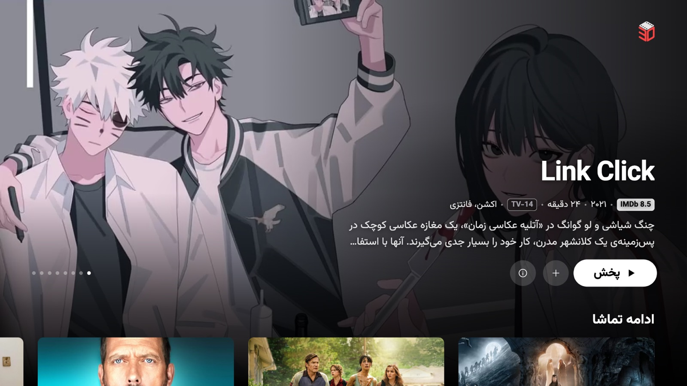
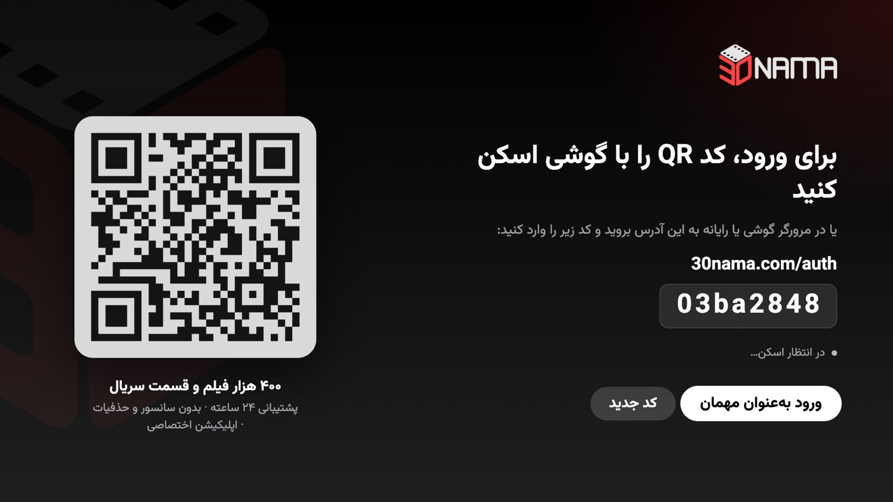
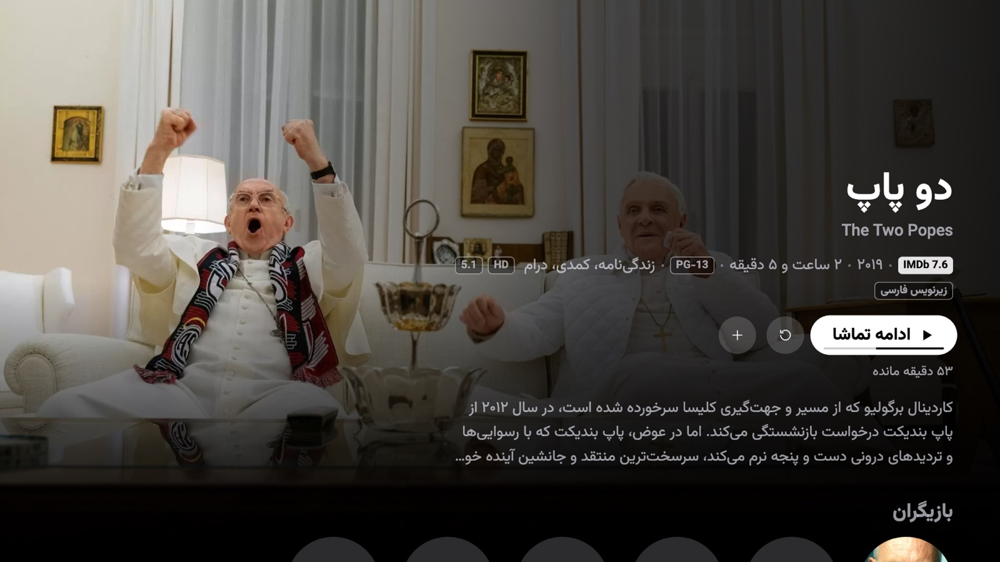
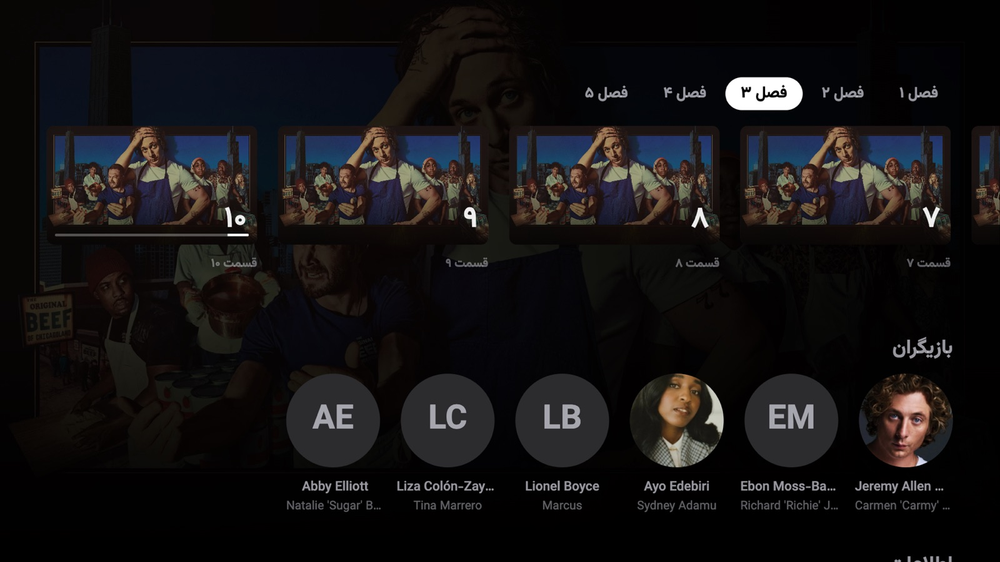
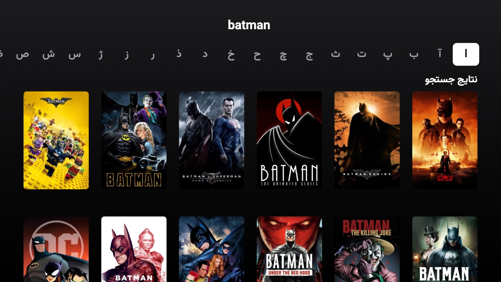
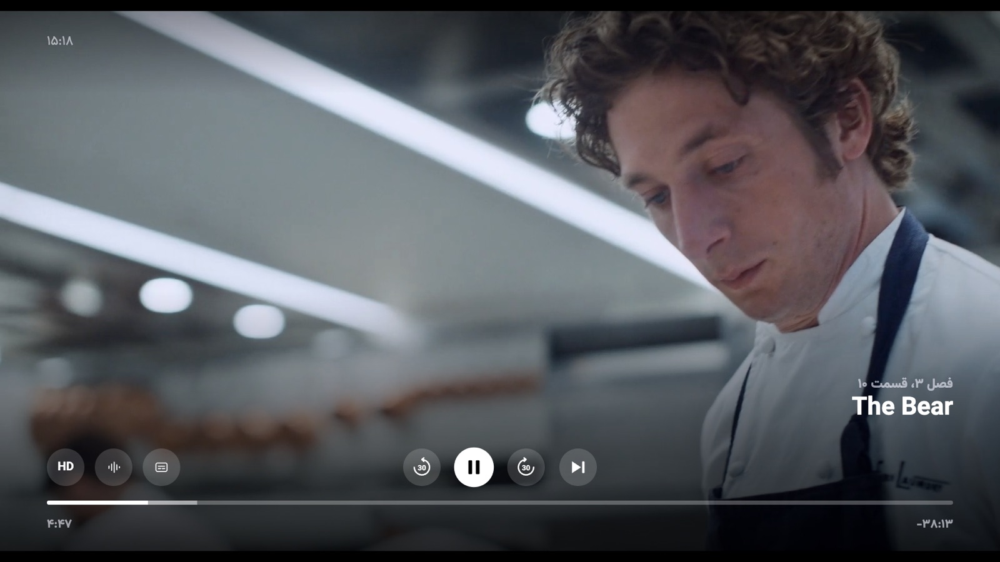

# 30nama TV for Samsung Tizen

An unofficial 30nama.com client for Samsung Tizen TVs, designed after the Apple TV app. Persian by default, with English as the alternative.



> **Disclaimer:** This is an unofficial, community project. It is not affiliated with, endorsed by, or supported by 30nama. You need your own valid 30nama subscription to use it. No content is bundled with this app.

## Features

- Apple TV (tvOS) style UI: floating sidebar, hero that scrolls away into shelves, product-style details pages
- Official 30nama branding; Persian UI with full right-to-left support, English titles everywhere
- Sign in by scanning a QR code with your phone (login required)
- Continue Watching with real progress, plus an In Progress section where you can remove items
- Watchlist row and My List
- Details with inline seasons and episodes, cast, resume and start over
- Player: -30s / play-pause / +30s / next episode, quality and audio (original, 5.1, stereo) menus, episodes panel
- Persian and English subtitles with live appearance settings: colour, size, background, position, weight
- Samsung AVPlay with HLS playback at the highest available quality (HTML5 + hls.js fallback)
- Optional TMDB enrichment: trending rows, cast and crew, reviews, recommendations

## Screenshots

| Login | Details |
|---|---|
|  |  |
| **Episodes** | **Search** |
|  |  |
| **Player** | |
|  | |

## Install

### Option 1: TizenBrew (simplest)

1. Turn on Developer Mode on the TV: open Apps, type `12345`, switch Developer mode on, enter your PC's IP address, then reboot the TV.
2. Install [TizenBrew](https://github.com/reisxd/TizenBrew/blob/main/docs/README.md) on the TV with the TizenBrew Installer (one-time).
3. In TizenBrew open Module Manager, Add GitHub Module, and enter `miladosos/30nama-tv`.
4. Launch "30nama" from the TizenBrew home screen.

Playback uses the TV's HTML5 player here (AVPlay is not available inside TizenBrew).

### Option 2: prebuilt .wgt

1. Turn on Developer Mode on the TV: open Apps, type `12345`, switch Developer mode on, enter your PC's IP address, then reboot the TV.
2. Download `30nama-v*.wgt` from the [latest release](https://github.com/miladosos/30nama-tv/releases/latest).
3. Install [Apps2Samsung](https://github.com/Apps2Samsung/Apps2Samsung/releases/latest) (Windows, Linux, macOS or Android). It handles your Samsung certificate and re-signs the package for your TV.
4. In Apps2Samsung select your TV, choose a custom `.wgt`, pick the downloaded file and install. Tizen 7+ TVs ask you to sign in to a Samsung account once to create a certificate.

### Option 3: build from source

First turn on Developer Mode on the TV: open Apps, type `12345`, switch Developer mode on, enter your PC's IP address, then reboot the TV.

Requires [Tizen Studio](https://developer.tizen.org/development/tizen-studio/download) (CLI tools + TV extension), a Samsung certificate that includes your TV's DUID, and Git Bash (the scripts target Windows + Git Bash; `TIZEN_HOME` defaults to `/c/tizen-studio`).

```
./install-wizard.sh                              # guided: reads the DUID, creates certificate and profile
./build.sh <security-profile> [<tv-ip>:26101]    # manual build; with a target it also installs and launches
```

## Optional: TMDB setup (build-from-source only)

This repo uses TMDB to add trending rows, cast, reviews and recommendations. It is off by default and the app works fully without it.

**Build-from-source only.** The token is baked in at build time, so this only applies when you [build from source](#option-3-build-from-source). The TizenBrew module and the prebuilt `.wgt` never include a token, so TMDB stays off there.

1. Create a free account at themoviedb.org and copy your **API Read Access Token** (v4) from Settings, API.
2. Copy the example file:
   ```
   cp tizen-app/js/tmdb-token.example.js tizen-app/js/tmdb-token.js
   ```
3. Open `tizen-app/js/tmdb-token.js` and paste the token between the quotes:
   ```js
   N.config.tmdbToken = 'eyJhbGciOi...';
   ```
4. Rebuild and reinstall. The Home screen then shows the extra rows, and Details gains cast, reviews and recommendations.

## Development

Run the app in a desktop browser with a small proxy (no dependencies, Node 18+):

```
cd tizen-app
node tools/devserver.js 8080
```

Then open http://localhost:8080/. The proxy forwards API and HLS requests to avoid CORS. See `tizen-app/README.md` for developer notes and `design/DESIGN.md` for the design spec.

## Structure

```
tizen-app/    the Tizen web app (config.xml, index.html, js/, css/, fonts/, tools/)
design/       design spec
docs/        README screenshots, TizenBrew notes
package.json TizenBrew module manifest
.github/     release workflow (experimental, manual run)
media/        poster
build.sh      build, sign and install
install-wizard.sh  guided TV setup
```

## Credits

This project started as a fork of [msharifi99/30nama-tizenos](https://github.com/msharifi99/30nama-tizenos) by Rebin Sharifi, which built the original Tizen app, the QR login, the AVPlay player, the TizenBrew packaging and the build tooling. Kudos and thanks to Rebin: this version is a redesign built on top of that work.

## License

Released under the [MIT License](LICENSE), keeping the original copyright notice. The Vazirmatn font in `tizen-app/fonts/` is licensed under the SIL Open Font License (see `tizen-app/fonts/OFL.txt`).
